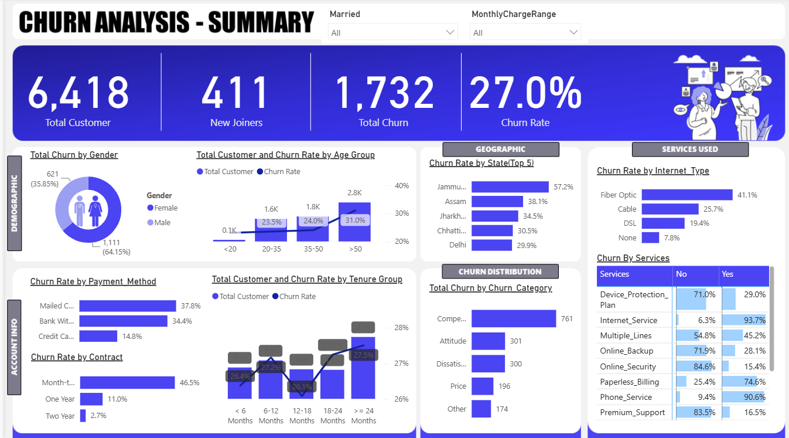
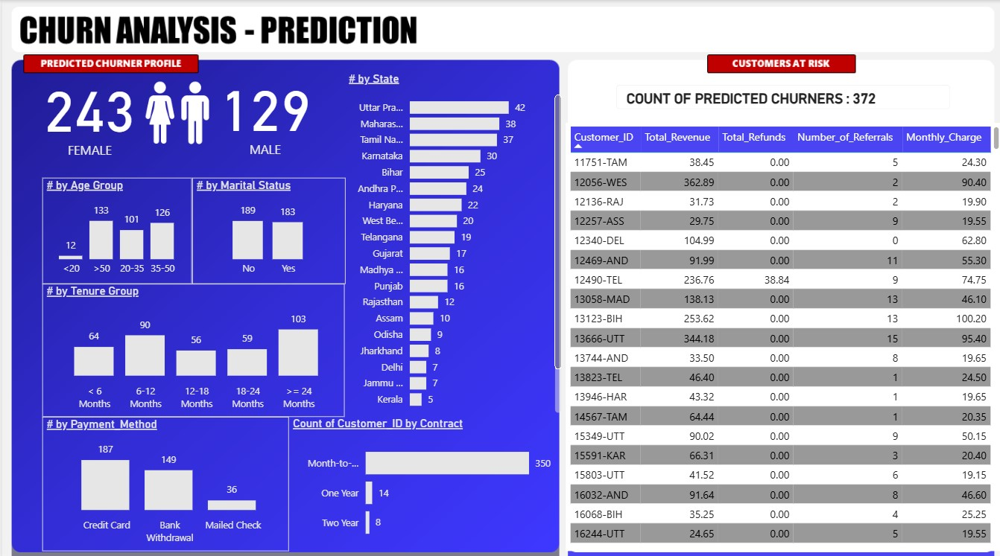

# 📊 Customer Churn Prediction System

<p align="center">
  
  
  
  
  
  
</p>

An end-to-end telecom customer churn intelligence system combining **SQL Server ETL**, **Python Machine Learning**, and **Power BI Interactive Business Intelligence** to proactively identify at-risk customers, uncover churn drivers, and guide data-driven retention strategies.

---

## 📑 Table of Contents

- [Executive Summary](#-executive-summary)
- [System Architecture](#-system-architecture)
- [Repository Structure](#-repository-structure)
- [Dataset Overview](#-dataset-overview)
- [Data Pipeline & SQL Engineering](#-data-pipeline--sql-engineering)
- [Machine Learning & Model Evaluation](#-machine-learning--model-evaluation)
- [Power BI Dashboard & Analytics](#-power-bi-dashboard--analytics)
- [Key Business Insights & Recommendations](#-key-business-insights--recommendations)
- [Installation & Setup](#-installation--setup)
- [Tech Stack](#-tech-stack)
- [Contributing](#-contributing)

---

## 📌 Executive Summary

Customer churn is one of the most critical threats to profitability in the telecommunications sector. Acquiring a new customer costs 5 to 7 times more than retaining an existing one.

This project delivers a **full-lifecycle data intelligence solution** that transforms raw transactional and demographic subscriber data into proactive retention workflows:

1. **Data Engineering (SQL Server):** Robust staging, data profiling, null handling, and production-ready views.
2. **Predictive Modeling (Python):** Training and benchmarking multi-class classification algorithms (**Logistic Regression**, **Random Forest**, and **XGBoost**) to predict customer status.
3. **Executive BI Reporting (Power BI):** Interactive multi-page dashboards with custom DAX calculations, cohort segmentation, and churn forecasting.

---

## 🏗️ System Architecture

```text
===================================================================================
                         END-TO-END SYSTEM ARCHITECTURE
===================================================================================

 [ 1. Raw Data Ingestion ]
         │
         ▼
 ┌─────────────────────────────────┐
 │  Customer_Data.csv (6,418 rows) │ ──► Demographic, Account & Usage Records
 └────────────────┬────────────────┘
                  │
                  ▼
 [ 2. SQL Server (ETL & Staging) ]
 ┌─────────────────────────────────┐
 │       Database: db_Churn        │
 │  ├── stg_Churn (Raw Staging)    │ ──► Data profiling & column-by-column null audits
 │  ├── Data Cleaning ETL          │ ──► ISNULL imputation for optional services & nulls
 │  ├── prod_Churn (Clean Table)   │ ──► Materialized production-ready dataset
 │  └── Analytical Views           │ ──► vw_ChurnData (Stayed/Churned) & vw_JoinData
 └───────┬─────────────────┬───────┘
         │                 │
         │ Cleaned Data    │ Production Views
         ▼                 │
 [ 3. Machine Learning ]   │
 ┌──────────────────────┐  │
 │  Python / Jupyter    │  │
 │  ├── Label Encoding  │  │
 │  ├── 80/20 Splitting │  │
 │  ├── Model Training: │  │
 │  │   • Log. Reg      │  │
 │  │   • Random Forest │  │
 │  │   • XGBoost       │  │
 │  └── Model Output    │  │
 └──────────┬───────────┘  │
            │              │
            ▼              ▼
 [ 4. Business Intelligence & Decision Support ]
 ┌────────────────────────────────────────────────────────┐
 │                   Power BI Desktop                     │
 │  ├── Power Query: Age/Tenure Buckets & Service Unpivot │
 │  ├── DAX Measures: Churn Rate, KPIs, Dynamic Counts    │
 │  ├── Page 1: Executive Summary Dashboard               │
 │  └── Page 2: Churn Prediction & Risk Analysis Dashboard│
 └────────────────────────────────────────────────────────┘
===================================================================================
```

### Architecture Pipeline Breakdown

| Pipeline Stage          | Component                      | Key Operations                                         | Output / Deliverable                        |
| ----------------------- | ------------------------------ | ------------------------------------------------------ | ------------------------------------------- |
| **1. Data Ingestion**   | CSV Dataset                    | Raw telecom records import (32 columns, 6,418 rows)    | `Customer_Data.csv`                         |
| **2. Storage & ETL**    | Microsoft SQL Server           | Null audits, category distribution, `ISNULL` cleansing | `prod_Churn`, `vw_ChurnData`, `vw_JoinData` |
| **3. Machine Learning** | Python (Scikit-Learn, XGBoost) | Preprocessing, feature encoding, model evaluation      | Evaluated models & churn risk predictions   |
| **4. BI & Analytics**   | Power BI Desktop               | Power Query transformations, DAX business logic        | Multi-page interactive executive dashboards |

---

## 📁 Repository Structure

```text
customer_churn_prediction/
│
├── data/
│   └── Customer_Data.csv              # Raw telecom customer dataset (6,418 rows)
│
├── notebooks/
│   └── churn_prediction_model.ipynb   # Model training & benchmarking (LR, RF, XGBoost)
│
├── sql/
│   └── churn_queries.sql              # Exploration, cleaning ETL, and analytical views
│
├── powerbi/
│   └── ChurnAnalysis.pbix             # Interactive Power BI dashboard report
│
├── docs/
│   └── Power_Query_and_DAX.md         # Data transformations and DAX measure dictionary
│
├── assets/
│   └── images/                        # High-resolution dashboard screenshots
│       ├── Summary.PNG                # Executive summary page preview
│       └── Prediction.PNG             # Churn prediction & risk analysis preview
│
├── requirements.txt                   # Python package dependencies
├── .gitignore                         # Git exclusion rules
└── README.md                          # Project documentation
```

---

## 📂 Dataset Overview

The dataset contains customer records across **32 features**, encompassing demographic information, contract terms, subscribed services, account financials, and churn classifications.

- **Total Customers:** 6,418
- **Target Variable (`Customer_Status`):**
  - `Stayed`: 4,275 (66.6%)
  - `Churned`: 1,732 (27.0%)
  - `Joined`: 411 (6.4%)

### Key Feature Categories

| Category                    | Primary Attributes                                                                                                                                                                                                                                                 |
| --------------------------- | ------------------------------------------------------------------------------------------------------------------------------------------------------------------------------------------------------------------------------------------------------------------ |
| **Demographics**            | `Customer_ID`, `Gender`, `Age`, `Married`, `State`, `Number_of_Referrals`                                                                                                                                                                                          |
| **Subscription & Services** | `Tenure_in_Months`, `Value_Deal`, `Phone_Service`, `Multiple_Lines`, `Internet_Service`, `Internet_Type`, `Online_Security`, `Online_Backup`, `Device_Protection_Plan`, `Premium_Support`, `Streaming_TV`, `Streaming_Movies`, `Streaming_Music`, `Unlimited_Data` |
| **Contract & Billing**      | `Contract` (Month-to-Month, One Year, Two Year), `Paperless_Billing`, `Payment_Method` (Bank Withdrawal, Credit Card, Mailed Check), `Monthly_Charge`                                                                                                              |
| **Financial Metrics**       | `Total_Charges`, `Total_Refunds`, `Total_Extra_Data_Charges`, `Total_Long_Distance_Charges`, `Total_Revenue`                                                                                                                                                       |
| **Churn Context**           | `Churn_Category`, `Churn_Reason`                                                                                                                                                                                                                                   |

---

## 🗄️ Data Pipeline & SQL Engineering

Data staging and cleaning were implemented using Microsoft SQL Server (`sql/churn_queries.sql`):

### 1. Profiling & Null Audit

- Evaluated category distributions and revenue contribution by churn status.
- Conducted full-table null scans across all 32 columns in `stg_Churn`.

### 2. Transformation & Cleansing (`prod_Churn`)

- Imputed categorical null values for optional add-on services:
  - `ISNULL(Online_Security, 'No')`, `ISNULL(Online_Backup, 'No')`, `ISNULL(Device_Protection_Plan, 'No')`
  - `ISNULL(Value_Deal, 'None')`, `ISNULL(Multiple_Lines, 'No')`, `ISNULL(Internet_Type, 'None')`
  - Handled churn reason and category defaults: `ISNULL(Churn_Category, 'Others')`, `ISNULL(Churn_Reason, 'Others')`.
- Materialized cleaned dataset into production table `[db_Churn].[dbo].[prod_Churn]`.

### 3. Business Views

- `vw_ChurnData`: Filters established customers (`Stayed`, `Churned`) for core retention analysis.
- `vw_JoinData`: Isolates recent joiners (`Joined`) for onboarding cohort tracking.

---

## 🤖 Machine Learning & Model Evaluation

The machine learning workflow (`notebooks/churn_prediction_model.ipynb`) addresses multi-class prediction across 29 predictive features with an **80/20 train-test split** (5,134 training samples, 1,284 evaluation samples).

### Data Preprocessing

- **Label Encoding:** Categorical string columns converted to numerical representations using Scikit-Learn `LabelEncoder`.
- **Target Classes:** `0: Churned`, `1: Joined`, `2: Stayed`.

### Model Performance Comparison

Three supervised classification algorithms were trained and evaluated on the identical holdout test set:

| Model                   | Hyperparameters / Setup                                       | Overall Accuracy | Macro F1-Score | Weighted F1-Score |
| ----------------------- | ------------------------------------------------------------- | :--------------: | :------------: | :---------------: |
| **Logistic Regression** | `max_iter=1000` (Baseline)                                    |      77.41%      |      0.65      |       0.77        |
| **Random Forest**       | `n_estimators=200`, `random_state=42`                         |    **83.33%**    |      0.73      |     **0.83**      |
| **XGBoost**             | `n_estimators=300`, `lr=0.05`, `max_depth=6`, `subsample=0.8` |      83.02%      |    **0.74**    |       0.82        |

### Detailed Classification Metrics (Test Set: N = 1,284)

#### 🌲 Random Forest Classifier (Best Overall Accuracy: 83.33%)

| Class           | Precision | Recall | F1-Score | Support |
| --------------- | :-------: | :----: | :------: | :-----: |
| **0 (Churned)** |   0.71    |  0.58  |   0.64   |   319   |
| **1 (Joined)**  |   0.74    |  0.56  |   0.64   |   89    |
| **2 (Stayed)**  |   0.87    |  0.95  |   0.91   |   876   |

#### ⚡ XGBoost Classifier (Best Macro F1: 0.74)

| Class           | Precision | Recall | F1-Score | Support |
| --------------- | :-------: | :----: | :------: | :-----: |
| **0 (Churned)** |   0.70    |  0.57  |   0.63   |   319   |
| **1 (Joined)**  |   0.73    |  0.62  |   0.67   |   89    |
| **2 (Stayed)**  |   0.87    |  0.95  |   0.91   |   876   |

> **Key Modeling Takeaway:** Ensemble methods significantly outperformed the linear baseline. Random Forest achieved the highest overall accuracy (**83.33%**), while XGBoost delivered the strongest balanced recall (**62%**) on the minority `Joined` class with **83.02%** accuracy.

---

## 📊 Power BI Dashboard & Analytics

The Power BI solution (`powerbi/ChurnAnalysis.pbix`) provides interactive decision support across two dedicated dashboards:

### Page 1: Executive Summary Dashboard

Tracks high-level telecom metrics, revenue at risk, churn distribution by geography, demographics, and contract types.



### Page 2: Churn Prediction & Risk Analysis

Monitors predicted churners from the machine learning model, customer vulnerability brackets, and service add-on adoption.



---

### Power Query Transformations & Modeling

To facilitate granular cohort analysis, custom dimensions and groupings were engineered:

- **`Churn Status`:** Binary flag (`1` if Churned, `0` otherwise).
- **`mapping_AgeGrp`:** Demographic cohorts (`< 20`, `20 - 35`, `36 - 50`, `> 50`) with numerical sort ordering.
- **`mapping_TenureGrp`:** Subscriber lifecycle cohorts (`< 6 Months`, `6-12 Months`, `12-18 Months`, `18-24 Months`, `>= 24 Months`).
- **`prod_Services`:** Unpivoted service attributes for multi-feature retention analysis.

### Core DAX Measures

```dax
-- Total Customer Volume
Total Customers = COUNT(prod_Churn[Customer_ID])

-- New Joiners
New Joiners = CALCULATE(COUNT(prod_Churn[Customer_ID]), prod_Churn[Customer_Status] = "Joined")

-- Total Churned Volume
Total Churn = SUM(prod_Churn[Churn Status])

-- Churn Rate Percentage
Churn Rate = [Total Churn] / [Total Customers]

-- Count of Model-Predicted Churners
Count Predicted Churner = COUNT(Predictions[Customer_ID]) + 0

-- Dynamic Header Card
Title Predicted Churners = "COUNT OF PREDICTED CHURNERS : " & COUNT(Predictions[Customer_ID])
```

_(Refer to [docs/Power_Query_and_DAX.md](docs/Power_Query_and_DAX.md) for full calculation logic)._

---

## 💡 Key Business Insights & Recommendations

1. **Contract Type is the Primary Churn Driver:**
   - Customers on **Month-to-Month contracts** exhibit the highest rate of attrition.
   - _Recommendation:_ Incentivize transitions to 1-year and 2-year contracts through loyalty discounts or bundled services.

2. **Early Tenure Vulnerability Window:**
   - Subscribers with **tenure < 6 months** demonstrate the steepest churn probability.
   - _Recommendation:_ Implement a targeted 90-day onboarding engagement sequence with dedicated customer service touchpoints.

3. **Value-Added Service Retention Multiplier:**
   - Customers who subscribe to `Online Security`, `Device Protection Plan`, and `Premium Support` churn at a significantly lower frequency.
   - _Recommendation:_ Bundle tech support and security protections into standard tier internet packages.

4. **Payment Method Sensitivity:**
   - Higher churn correlation is observed with manual payment mechanisms versus automated credit card / direct debit accounts.
   - _Recommendation:_ Offer one-time bill credits to incentivize automatic payment enrollment.

---

## 🚀 Installation & Setup

### Prerequisites

- Python 3.9+
- Microsoft SQL Server / SQL Server Management Studio (SSMS)
- Microsoft Power BI Desktop

### 1. Clone the Repository

```bash
git clone https://github.com/Tanuj-Narula/customer-churn-prediction.git
cd customer-churn-prediction
```

### 2. Set Up Python Environment

```bash
# Create a virtual environment
python -m venv venv

# Activate the virtual environment
# Windows:
venv\Scripts\activate
# macOS/Linux:
source venv/bin/activate

# Install required dependencies
pip install -r requirements.txt
```

### 3. Database Ingestion & SQL Scripts

1. Create database `db_Churn` in SQL Server.
2. Import `data/Customer_Data.csv` into staging table `stg_Churn`.
3. Open and execute `sql/churn_queries.sql` in SSMS to generate `prod_Churn`, `vw_ChurnData`, and `vw_JoinData`.

### 4. Machine Learning Model Execution

```bash
jupyter notebook notebooks/churn_prediction_model.ipynb
```

- Execute all notebook cells to inspect exploratory data analysis, train Logistic Regression, Random Forest, and XGBoost models, and review performance reports.

### 5. Launch Power BI Dashboard

- Open `powerbi/ChurnAnalysis.pbix` in **Power BI Desktop**.
- If needed, update the data source connection parameters to point to your local SQL Server instance or cleaned dataset.

---

## 🧰 Tech Stack

| Domain                      | Tool / Library        | Purpose                                                                 |
| --------------------------- | --------------------- | ----------------------------------------------------------------------- |
| **Data Storage**            | Microsoft SQL Server  | Relational database hosting staging and production customer tables      |
| **Data Processing & ETL**   | T-SQL                 | Data profiling, null remediation, data staging, and analytical views    |
| **Programming Language**    | Python 3.9+           | Data science scripting and modeling pipeline                            |
| **Machine Learning**        | Scikit-Learn, XGBoost | Classification algorithms (Logistic Regression, Random Forest, XGBoost) |
| **Data Manipulation**       | Pandas, NumPy         | Data cleaning, encoding, array operations                               |
| **Visualization & BI**      | Power BI Desktop, DAX | Multi-page dashboards, metric modeling, cohort analytics                |
| **Development Environment** | Jupyter Notebook      | Interactive exploratory data analysis and model benchmarking            |

---

## 🤝 Contributing

Contributions, issues, and feature requests are welcome!

1. Fork the Project
2. Create your Feature Branch (`git checkout -b feature/AmazingFeature`)
3. Commit your Changes (`git commit -m 'Add some AmazingFeature'`)
4. Push to the Branch (`git push origin feature/AmazingFeature`)
5. Open a Pull Request

---
